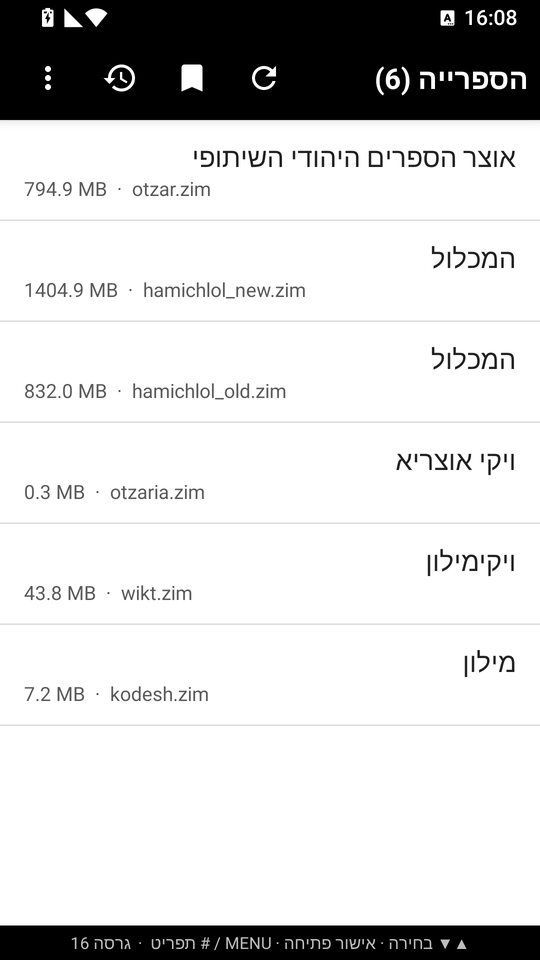
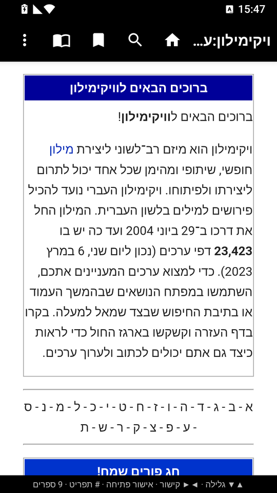
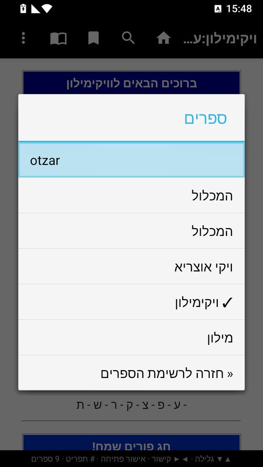
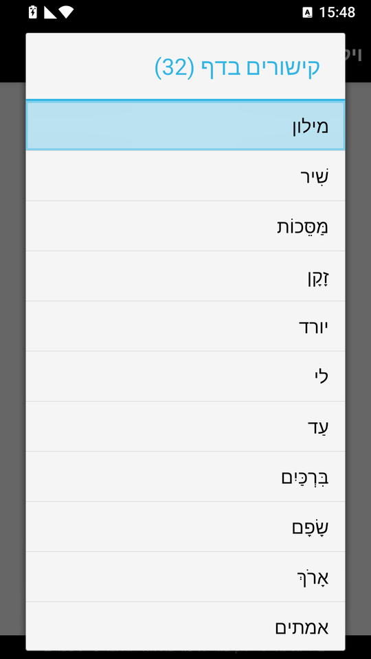
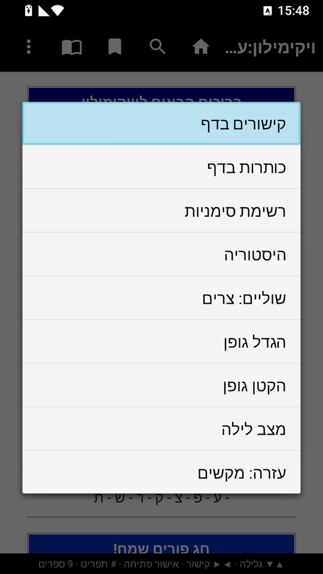
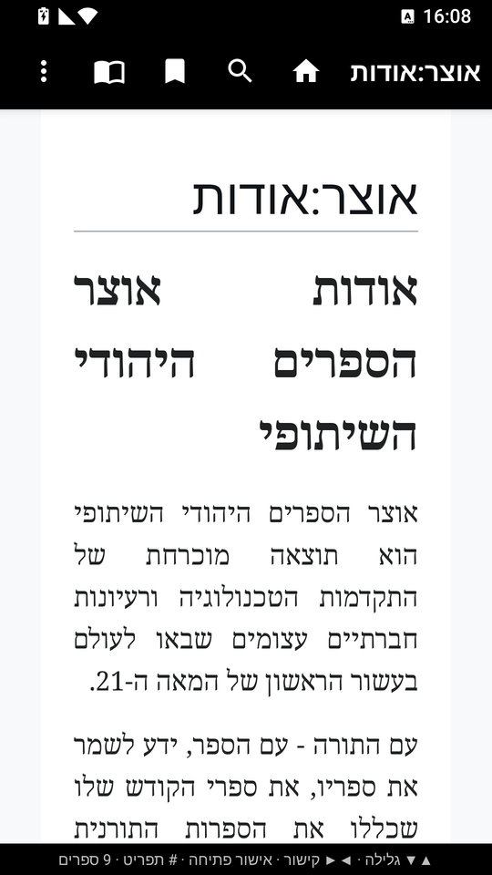
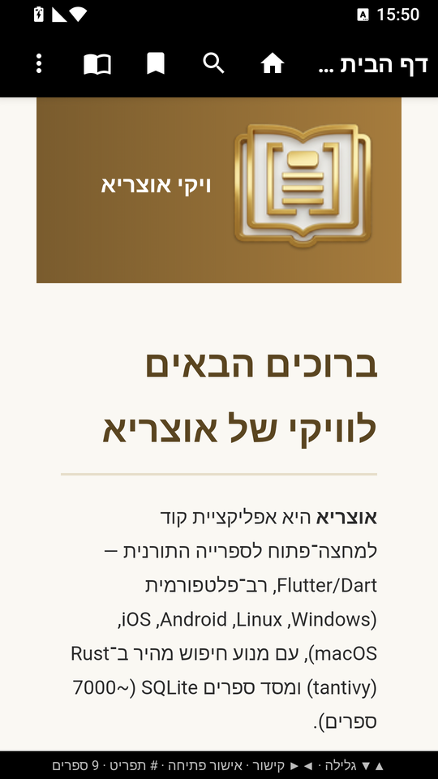
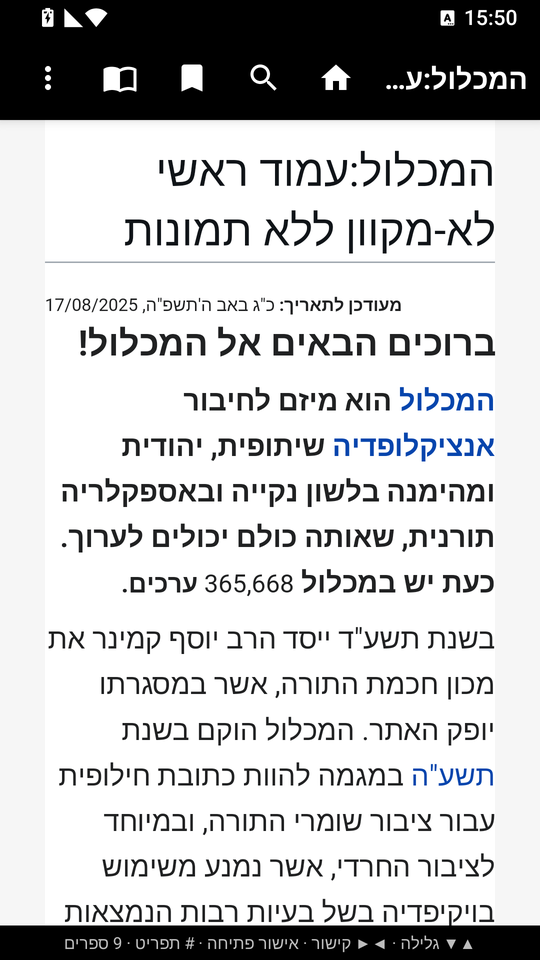

# קורא ZIM

אפליקציית אנדרואיד לקריאת קבצי ZIM (ויקיפדיה ודומיו) במצב לא מקוון.
`minSdk 19` (אנדרואיד 4.4), `targetSdk 34`. עובדת במכשירי מקשים ובמגע.

- קורא ZIM גרסאות 5 ו-6, דחיסות none / xz / zstd, סכמת מרחבי שמות ישנה וחדשה.
- סריקת האחסון, כמה ספרים יחד, חיפוש כותרות (תחילית), סימניות והיסטוריה.
- גודל גופן, מצב לילה, ממשק מימין לשמאל.
- עיצוב בהשראת Kiwix.

## צילומי מסך

|  |  |  |
|---|---|---|
|  |  |  |
|  |  |  |
|  |  |  |

## מקשים

| מקש | פעולה |
|---|---|
| חצים מעלה/מטה | גלילה |
| חצים ימינה/שמאלה, 4/6 | קישור קודם / הבא |
| אישור, 5 | פתיחת הקישור המסומן |
| 2 / 8 | עמוד מעלה / מטה |
| 1 | דף ראשי |
| * | חיפוש |
| # או MENU | תפריט |

## בנייה

הבנייה נעשית ב-GitHub Actions (ראו `.github/workflows/build.yml`). ה-APK מצורף לכל Release.

הערה על חיפוש: אינדקס החיפוש המלא שבתוך קבצי ZIM (Xapian) הוא מסד נתונים בינארי מורכב שאין לו קורא ב-Java, ולכן
האפליקציה מחפשת בתוכן בסריקה ישירה של המאמרים (עם התאמה עברית: בלי ניקוד, אותיות סופיות, אותיות שימוש).
בקבצים גדולים החיפוש בתוכן איטי יותר; חיפוש כותרות מהיר.
